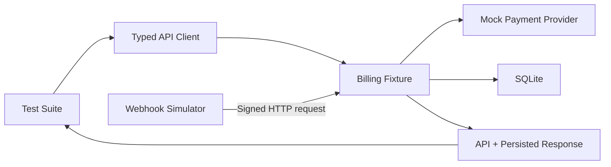
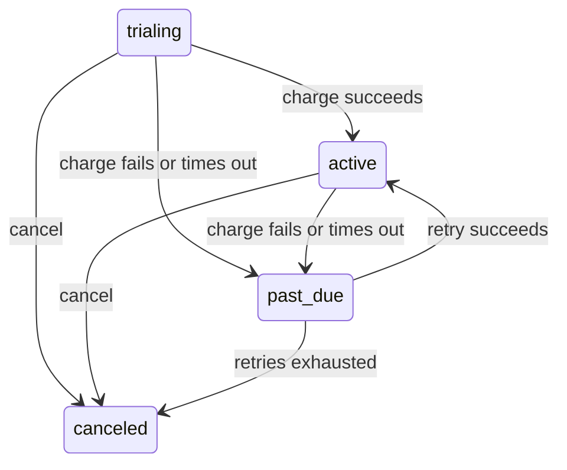
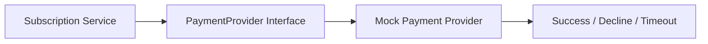
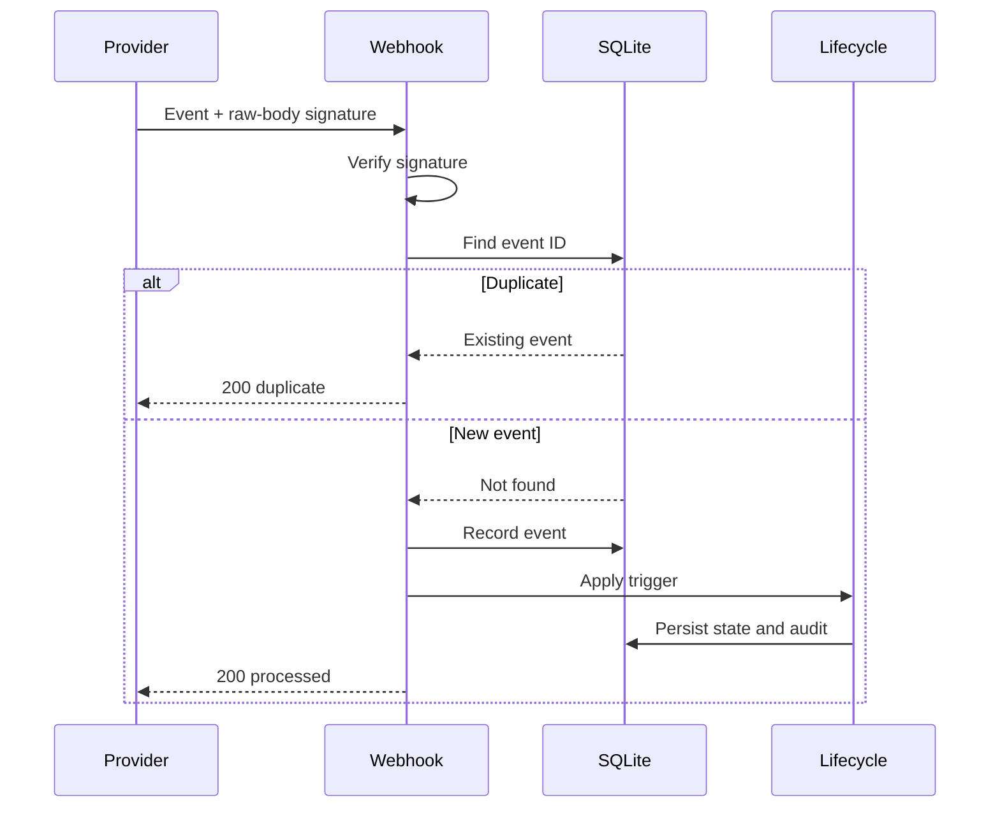

# Subscription & Billing — Implementation Plan

## 1. Goal

Create a TypeScript automation suite for a small local Subscription & Billing service fixture.

The solution will demonstrate:

- API, lifecycle, database, webhook, and payment-provider validation.
- Real local HTTP and SQLite behavior.
- Mocked external payment provider behavior.
- Clear, reusable object-oriented test code.

This follows **Option 2: build a minimal service fixture**. It is not a production billing system.



## 2. Scope

### Included

- Create, retrieve, cancel, and change subscription plans.
- Lifecycle transitions.
- Success, failure, timeout, refund, duplicate, and stale webhooks.
- Valid and invalid HMAC signatures.
- Mock provider call count and arguments.
- SQLite subscriptions, invoices, payments, webhook events, and audit records.
- Invalid API requests and invalid state transitions.

### Excluded

- Real payment provider.
- Authentication and authorization.
- Background scheduling infrastructure.
- Taxes, discounts, partial refunds, and currency conversion.
- Performance testing.

## 3. Fixture Contract

The assignment does not specify exact plan prices or trial lengths, so this fixture uses fixed values:

| Item | Behavior |
|---|---|
| Basic | 1900 cents/month, 7-day trial, USD |
| Pro | 4900 cents/month, 14-day trial, USD |
| Creation | Initial state `trialing`; no provider charge |
| Trial success/failure | `trialing -> active` or `past_due` |
| Active failure/timeout | `active -> past_due` |
| Retry success/exhaustion | `past_due -> active` or `canceled` |
| Cancellation | `trialing/active -> canceled` |
| Refund | Update refund records; keep lifecycle status unchanged |
| Plan change | Update plan; no immediate charge or proration |

All plan values come from one plan catalog used by creation, invoices, and provider calls.

## 4. Real vs. Mocked

| Component | Implementation | Verification |
|---|---|---|
| HTTP fixture | Real local server | Routes, status codes, payloads, and headers |
| Subscription lifecycle | Real fixture code | Valid/invalid transitions |
| SQLite persistence | Real embedded database | Entity state, references, counts, and audit history |
| Payment provider | Mock/fake interface | Success, decline, timeout, call count, and arguments |
| Inbound webhooks | Test-side signed HTTP requests | Signature, malformed payload, duplicate, stale, and canceled behavior |
| Time | Injected test clock | Deterministic trial expiry and retry timestamps |

This keeps the test deterministic: no real card/network call is made and no external provider is assumed to exist.

## 5. API Contract

| Operation | Success | Bad request | Not found | Invalid state |
|---|---:|---:|---:|---:|
| Create | 201 | 400 | 404 | 422 |
| Retrieve | 200 | — | 404 | — |
| Cancel | 200 | — | 404 | 422 |
| Change plan | 200 | 400 | 404 | 422 |
| Webhook | 200 | 400/401 | — | Safe ignore |

Create example:

```json
{
  "customer_id": "cust_001",
  "plan": "pro",
  "payment_method_id": "pm_test_visa_4242"
}
```

Creation checks customer, plan, and payment method, then starts the subscription in `trialing` without calling the provider.

Cancellation is allowed from `trialing` or `active` and makes no provider call. Canceling an unknown or already-canceled subscription returns `404` or `422`.

Plan changes are allowed from `trialing` or `active`. Unknown plans return `400`; unknown subscriptions return `404`; canceled or past-due subscriptions return `422`. The next billing attempt uses the new plan amount.

Every successful response and error payload will have an explicit, typed shape. A standard error shape will contain `code`, `message`, and optional `field` or `details`. Tests will validate the shape as well as status codes.

For creation, retrieval, cancellation, and plan-change responses, tests will verify:

- Subscription ID, customer ID, plan, status, timestamps, and state version.
- Unknown customer/payment method and invalid plan errors.
- Missing required fields and malformed JSON.
- No subscription, invoice, audit, or provider side effect after rejected requests.

## 6. Webhook Contract

```text
POST /webhooks/payment-provider
X-Provider-Signature: HMAC-SHA256(raw request body)
```

The server verifies the signature over the exact raw body.

- Missing or invalid signature: `401`.
- Malformed JSON or missing fields: `400`.
- Unsupported event: `400`.
- Valid duplicate: `200`, status `duplicate`.
- Valid stale or canceled event: `200`, status `ignored`.

## 7. Lifecycle



The service must reject or ignore:

- Canceled subscription receiving success or failure.
- Active subscription changing directly to trialing.
- A stale success reactivating a canceled or exhausted subscription.
- Any status change not defined in the transition table.

Status values are changed only by `SubscriptionLifecycle`, not by API or webhook call sites.

## 8. Persistence

SQLite provides durable, queryable records and unique webhook-event constraints.

| Entity | Important fields |
|---|---|
| Subscription | ID, customer, plan, status, trial end, state version |
| Invoice | ID, subscription, amount, currency, status, attempt number |
| Payment event | Subscription, invoice, type, amount, currency |
| Webhook event | Unique event ID, type, signature, processing status |
| Audit event | Subscription, old status, new status, trigger, reference |

Required invariants:

- An active subscription has at least one successful payment.
- A canceled subscription never changes again.
- A duplicate event creates no duplicate invoice, payment, audit, or provider side effect.
- API state and persisted state always agree.
- Refund does not activate or cancel a subscription.
- Plan price and trial configuration remain consistent.

## 9. Mock Payment Provider



Interface:

```typescript
interface PaymentProvider {
  charge(request: ChargeRequest): Promise<ChargeResult>;
}
```

The mock will support success, decline, and timeout. Tests will assert:

- Customer ID.
- Payment method ID.
- Amount.
- Currency.
- Invoice/provider reference.
- Idempotency key.
- Exact call count.

Provider calls occur once for a genuine billing attempt only. They must not occur for creation, cancellation, invalid requests, or duplicate webhooks.

A timeout or decline leaves no successful payment record and moves a due subscription to `past_due`.

## 10. Webhook Processing



Processing order:

1. Verify raw-body signature.
2. Validate payload fields.
3. Search for the event ID.
4. Return for a duplicate.
5. Record the new event.
6. Verify subscription and invoice references.
7. Apply a valid lifecycle transition.
8. Persist state and audit changes.

## 11. Project Structure

```text
src/
  app/             HTTP fixture and routes
  api/             Typed API client
  domain/          Subscription, plan, and state machine
  providers/       Payment interface and mock
  persistence/     SQLite repositories
  webhooks/        Signature verification and simulation
  fixtures/        Test fixture and test clock
  builders/        Test data builders
  assertions/      API, database, and provider assertions
  tests/           API, lifecycle, webhook, persistence, end-to-end
```

Each test creates a fresh database and mock provider. No test shares mutable state with another test.

### Test environment setup

Each fixture will:

- Seed known plans and test customers.
- Create one empty SQLite database per test or isolated transaction.
- Inject the mock provider and test clock.
- Start a local server or create an in-process app instance.
- Clean up the server and database after execution.

This prevents stale rows or shared provider calls from creating false positives. A unique event ID and unique subscription ID are used for every scenario.

## 12. Design Patterns

### State table / State pattern

`SubscriptionLifecycle` centrally defines valid transitions. It prevents ad hoc status mutation and makes illegal transitions difficult to implement.

### Builder

Builders make scenario setup readable:

```typescript
const webhook = new WebhookPayloadBuilder()
  .eventId("evt_success_001")
  .paymentSucceeded()
  .subscriptionId(subscription.id)
  .invoiceId("inv_001")
  .amount(4900)
  .build();
```

### Payment-provider interface

Dependency injection allows the service to use a mock instead of a real provider.

### Repository

Repositories keep SQL out of tests and assertions domain-oriented.

## 13. Test Coverage

### API

- Create basic and pro subscriptions.
- Retrieve existing and unknown subscriptions.
- Cancel trialing and active subscriptions.
- Reject repeated cancellation.
- Reject unknown plan, customer, payment method, and plan change.
- Test malformed webhook requests.

### Lifecycle

- `trialing -> active`.
- `trialing -> past_due`.
- `active -> past_due`.
- `past_due -> active`.
- `past_due -> canceled`.
- `trialing/active -> canceled`.
- Canceled success/failure remains ignored.
- Active cannot return to trialing.

### Provider and webhooks

- Success, decline, and timeout.
- Missing, invalid, and valid signatures.
- Duplicate success, failure, and refund events.
- Failure after success does not regress active status.
- Stale event does not override newer state.
- Exact provider call count and arguments.

### Persistence

- Creation creates one subscription and no invoice.
- Success creates a paid invoice/payment record.
- Failure creates a failed record and past-due state.
- Duplicate delivery creates no duplicate rows.
- Invalid requests create no side effects.
- API state matches database state.

### Database consistency

- Timestamps are coherent: creation before update, billing before payment event, and cancellation before canceled audit state.
- Provider references connect to the correct invoice and subscription.
- No active subscription is based only on failed invoices.
- No canceled subscription has a later active audit transition.
- Refund has matching refund payment, invoice, webhook, and audit records.

### End-to-end

1. Pro trial → success → active.
2. Pro trial → decline → past due → retry success → active.
3. Active → failure → past due → retries exhausted → canceled.
4. Active → cancel → success webhook → remain canceled.
5. Active plan change → next billing uses the new plan amount.

## 14. Red–Blue–Green

### Red

Write one focused failing test.

Example: an active subscription receiving `payment.failed` must become `past_due`.

### Blue

Implement the smallest required behavior: route, webhook update, provider result, and persistence update.

### Green

Refactor after tests pass:

- Add builders and fixtures.
- Centralize repositories and assertions.
- Remove setup duplication.

## 15. Implementation Order

1. Set up TypeScript, test runner, HTTP server, and SQLite.
2. Implement plan catalog and state-machine transitions.
3. Implement create, retrieve, cancel, and plan change.
4. Add repositories and persisted-state assertions.
5. Add payment-provider interface and mock.
6. Add signed webhook handling and duplicate detection.
7. Add end-to-end flows and stale-event cases.
8. Refactor and run final validation.

## 15.1 Technology and Delivery

The intended stack is:

- **TypeScript** with Jest or Vitest.
- **Supertest** for real HTTP requests to the local fixture.
- **better-sqlite3** or an equivalent embedded database.
- Built-in Jest/Vitest mocks for the payment-provider interface.

The PR will include setup instructions, test commands, clean setup validation, implementation documentation, and a completed PR description. The PR description will separately explain strategy, patterns, API/database validation, mock interactions, architecture, limitations, and responsible AI usage.

## 16. Validation Commands

```text
npm test
npm run lint
npm run typecheck
npm run build
npm run validate
```

## 17. Reliability Rules

- Fresh fixture and database for every test.
- Unique IDs prevent stale test records.
- SQLite unique constraint for webhook event IDs.
- Test clock instead of real trial-expiration waits.
- Exact raw-body webhook signatures.
- HTTP request timeouts.
- Assert API, SQLite, and provider behavior in one scenario.

## 18. Known Limitations

- The fixture demonstrates behavior but is not production billing software.
- Timeout is simulated by the provider interface, not a real network timeout.
- Retry scheduling is deterministic rather than background-based.
- Concurrent/racing duplicate webhook delivery is bonus coverage if implementation time remains; mandatory duplicate and stale delivery comes first.
- Plan changes do not include proration or immediate charges.
- Notifications are represented by an optional recorder.

### Responsible AI Usage

AI assistance may be used while implementing this solution.

- It can help draft test structure, fixtures, documentation, and repetitive code.
- I will personally review generated code and documentation.
- I will verify the lifecycle rules, persistence behavior, API contracts, and mock interactions against the assignment.
- I will run and inspect the test suite, lint, type-check, build, and clean setup before submission.
- The final PR description will clearly disclose which implementation areas AI helped with and which files or behavior I personally corrected.

## 20. Definition of Done

- Every valid lifecycle transition has a test.
- Canceled and active-to-trialing invalid transitions are impossible.
- Duplicate and stale webhooks are covered.
- Valid and invalid signatures are separated and tested.
- Provider call count and arguments are exact.
- Persistence matches the API-visible lifecycle state.
- Invalid requests create no side effects.
- Plan changes update the next billing amount correctly.
- Tests pass lint, type-check, build, and clean setup validation.
